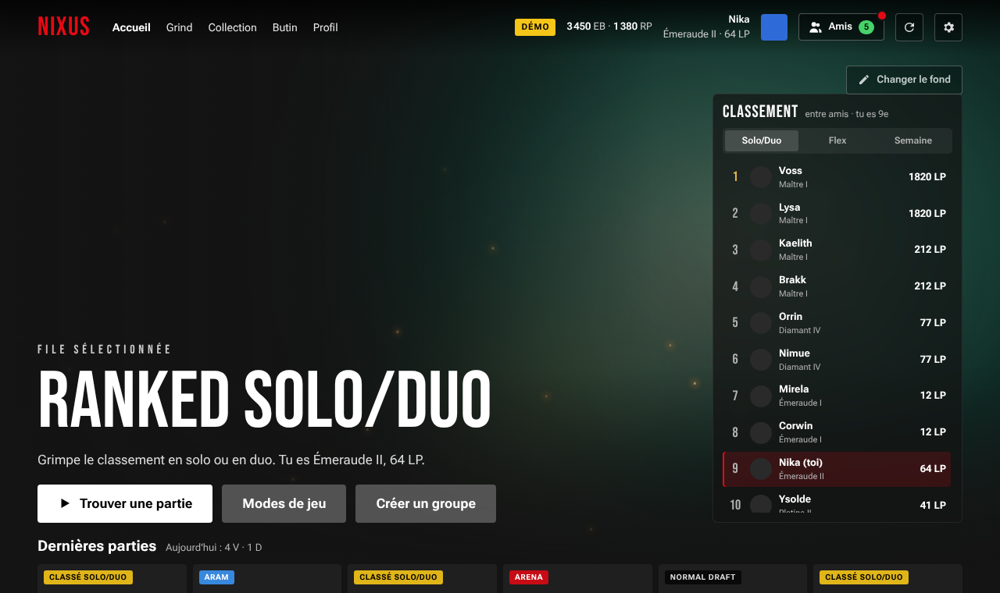
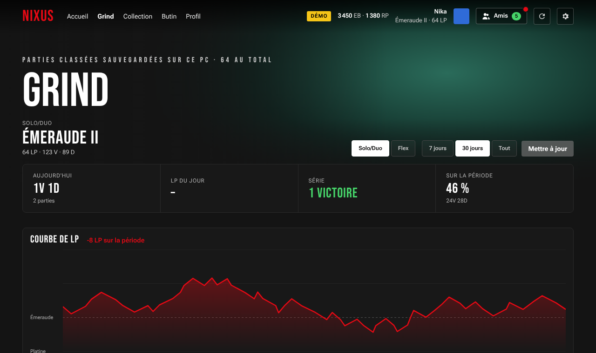
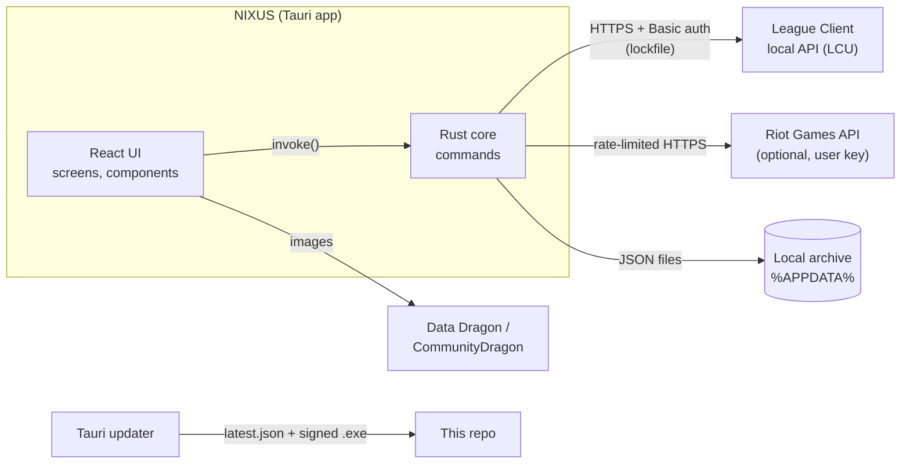

<div align="center">

# NIXUS

**A modern, cinema-style desktop client for League of Legends.**

Built with Tauri 2, React 19 and Rust. NIXUS plugs into the official Riot client and replaces its interface for the lobby, matchmaking, champion select, profile and post-game, then adds a ranked-grind tracker on top.


[](https://github.com/NIKAerer/NIXUS/actions/workflows/ci.yml)

</div>

> The interface is in French. Screenshots below come from the built-in **demo mode** (fake data, no Riot client needed).




## Why

The official League client is heavy and its UI has grown over a decade. NIXUS is a personal take on what it could look like with a streaming-app aesthetic: full-bleed splash art, big typography, fast transitions, and the stats a ranked player actually checks, all in a ~2 MB installer.

## Features

**Play**
- Home with the selected queue, recent games and a friends leaderboard (Solo/Duo, Flex, weekly progress).
- Game mode picker laid out like the Riot client: Summoner's Rift, ARAM, Arena, rotating modes, co-op vs AI, custom games (create, join, password, sides and spectators).
- Party management, invitations, matchmaking bar with timer and estimated wait, ready check with sound and window focus.

**Champion select**
- Full draft grid with bans, picks, trades, pick-order and position swaps.
- Skin picker, large rune page editor, summoner spells, team chat.
- ARAM bench and rerolls.
- Subtle "breathing" animation on splash arts, paused off-screen to keep the GPU quiet.

**In game and after**
- In-game screen, end-of-game recap, honor ballot and player reports.
- Match detail with timeline, gold difference and a 2D replay of champion positions on the map.

**Grind tracker**
- Every ranked game is archived locally with its detail and timeline.
- LP curve, today's session, streak, KDA/KP/CS, CS at 10, gold diff at 10 and 15 against the lane opponent, by champion, role and matchup.
- Optional import of past Solo/Duo games through the Riot API (the user's own key, rate-limited client side).
- Backup and restore of the archive as a JSON file.

**Social and profile**
- Friends panel with groups, Riot ID search, friend requests and direct messages.
- Profile with stats, title, challenge tokens and icon customisation; collection and loot pages.

**Desktop app**
- Frameless window with custom controls.
- Can start League on its own and hide the Riot client window while idle to save RAM.
- Signed auto-updates (Tauri updater) served from this repository.

## Architecture



| Layer | Where | What it does |
| --- | --- | --- |
| LCU bridge | `src-tauri/src/lcu.rs` | Finds the League client's port and one-time password (lockfile, or the process command line as a fallback) and proxies requests to its local HTTPS API. |
| Riot API | `src-tauri/src/riot.rs` | Calls the public Riot API with the key the user pastes in Settings, spaced 1.25 s apart and honouring `Retry-After`. |
| Archive | `src-tauri/src/archive.rs` | Stores games and timelines as JSON in the app data folder, with id validation, stats, export and import. |
| Launch and usage | `src-tauri/src/launch.rs`, `usage.rs` | Starts League, checks whether the client UI is running, reports RAM and CPU. |
| Client state | `src/lib/useClient.ts` | Polls the LCU and turns the gameflow phase into the screen to show. |
| Demo mode | `src/lib/mock.ts`, `mockGame.ts` | When the app runs in a plain browser, every LCU call is answered by an in-memory fake client, so the whole UI can be developed and shown without League. |

No account credentials ever go through NIXUS: the Riot client handles login, and the LCU password is regenerated by Riot at each launch and only kept in memory.

## Getting started

### Try the demo in a browser

Requires Node.js 20+.

```bash
npm ci
npm run dev
```

Open http://localhost:1420. A **DÉMO** badge shows that the fake client is in use.

### Run the desktop app

Requires Windows, Node.js 20+, [Rust](https://rustup.rs) and the [Tauri prerequisites](https://tauri.app/start/prerequisites/). League of Legends should be installed.

```bash
npm ci
npm run tauri dev
```

### Build an installer

```bash
npm run tauri build
```

The NSIS installer lands in `src-tauri/target/release/bundle/nsis/`.

Update artifacts are signed. To build signed packages, generate your own key pair (`npm run tauri signer generate -w .signing/nixus.key`), put the public key in `src-tauri/tauri.conf.json` under `plugins.updater.pubkey`, and set the variables listed in [`.env.example`](.env.example). The `.signing/` folder is git-ignored and must never be committed.

### Riot API key (optional)

The Grind import uses a personal Riot API key from [developer.riotgames.com](https://developer.riotgames.com). Paste it in **Paramètres > Clé API Riot**. It is stored on your PC only and is never part of the source code.

## Project layout

```
src/                React UI
  screens/          Home, ChampSelect, InGame, EndOfGame, Grind, Profile, Collection, Loot
  components/       Draft, runes, friends, chat, match detail, replay, settings…
  lib/              LCU client, demo mode, archive, Data Dragon, settings, updater
src-tauri/          Rust backend (Tauri 2)
  src/              lcu, riot, archive, launch, usage
latest.json         Update manifest read by the in-app updater
releases/           Signed installers
```

## Roadmap

- Profile banner customisation.
- Reliable team side switching in custom lobbies.
- Releases published as GitHub Releases, built and signed by GitHub Actions.
- Code splitting for a lighter first load.
- Unit tests for the archive and stats calculations.
- English translation of the interface.

## Legal

NIXUS isn't endorsed by Riot Games and doesn't reflect the views or opinions of Riot Games or anyone officially involved in producing or managing Riot Games properties. Riot Games, and all associated properties are trademarks or registered trademarks of Riot Games, Inc.

NIXUS only uses the League client's local API and the public Riot API. It does not read or modify game memory or files.

The source code is released under the [MIT License](LICENSE).
